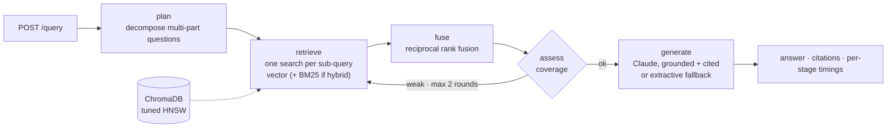
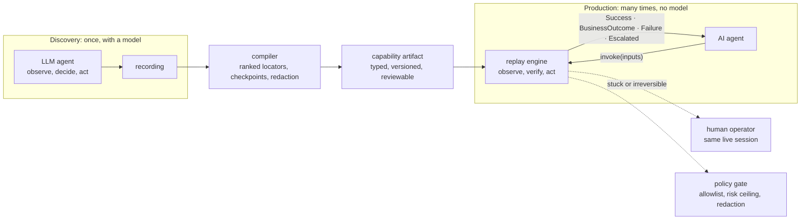
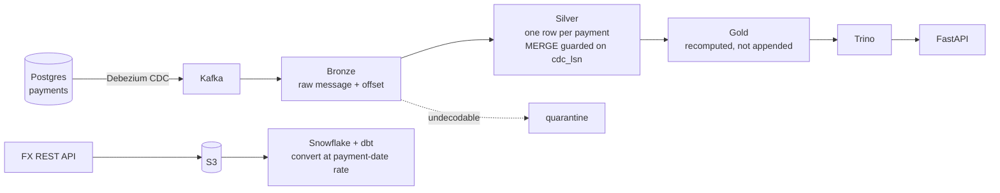
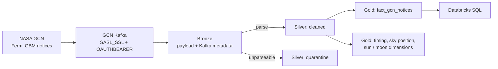
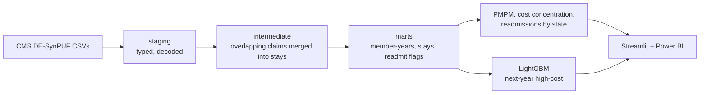

<a href="https://harshitgadge.github.io">
  <picture>
    <source media="(max-width: 600px) and (prefers-color-scheme: dark)" srcset="assets/hero-phone-dark.svg?v=3">
    <source media="(max-width: 600px)" srcset="assets/hero-phone-light.svg?v=3">
    <source media="(prefers-color-scheme: dark)" srcset="assets/hero-dark.svg?v=3">
    <source media="(prefers-color-scheme: light)" srcset="assets/hero-light.svg?v=3">
    
  </picture>
</a>

  <a href="https://www.linkedin.com/in/harshitg-">LinkedIn</a> ·
  <a href="mailto:harshit.gadge.1805@gmail.com">harshit.gadge.1805@gmail.com</a> ·
  <a href="#experience">Experience</a> ·
  <a href="#try-it-live">Try it live</a> ·
  <a href="#featured-work">Featured work</a> ·
  <a href="#how-they-work">How they work</a>

I'm an AI and data engineer. I've just finished an MS in Data Science at the University of Maryland (GPA 3.95). I'm an **AI Engineer Intern at Causify.AI** and work on **Prof. GP Saggese's research team at UMD**. I'm also co-inventor on an **Indian patent** for electromagnetic simulation and machine learning for non-invasive lung tumor prediction.

Each of my projects comes with a number and a test that backs it up.

**I'm looking for a full-time AI Engineer, Data Engineer or Data Scientist role, and I can start right away.**

## Experience

| Role | Where | When | What I worked on |
|---|---|---|---|
| **AI Engineer Intern** | Causify.AI · remote | Nov 2026 – now | AI engineering work alongside Prof. GP Saggese's research team |
| **Data Analyst Intern** | Small Business Development Center · College Park, MD | Mar 2026 – Sep 2026 | SQL analysis of client outcomes that helped leadership decide where advisors spend their hours |
| **Technical Systems & Data Intern** | WENITE Inc. · remote | Dec 2025 – Feb 2026 | Versioned training datasets with Spark preprocessing, and checking an LLM data agent on an evaluation set before its pilot |
| **Data Analytics Engineer** | Kuhoo Finance · lending fintech, India | Oct 2023 – Jul 2024 | KYC and fraud-screening rules, AWS Glue and PySpark pipelines, A/B tests on the loan funnel |
| **Data Analyst** | KPMG India | Jun 2023 – Sep 2023 | Customer segmentation and automated data-quality checks |

## Try it live

| Demo | What you'll see |
|---|---|
| **[Ask my portfolio →](https://harshitgadge.github.io)** | A chat page on the RAG service from the animation above, which has indexed the design docs of five of the projects below (all but fraud screening). Each glowing dot is one indexed passage; ask a question and watch the passages it uses light up, with every answer line cited to its source. It's read-only, and on a free instance the first question after a quiet spell takes about a minute. ([raw API](https://agentic-rag-service-fxsc.onrender.com/docs)) |
| **[Medicare claims dashboard →](https://hgadge-medicare-claims.streamlit.app)** | PMPM, cost concentration, readmissions and state comparisons over 108k synthetic Medicare members, built from the dbt marts. |

## Featured work

  <a href="https://github.com/HarshitGadge/agentic-rag-service"><picture><source media="(prefers-color-scheme: dark)" srcset="assets/card-agentic-rag-service-dark.svg?v=3"></picture></a>
  <a href="https://github.com/HarshitGadge/capability-runtime"><picture><source media="(prefers-color-scheme: dark)" srcset="assets/card-capability-runtime-dark.svg?v=3"></picture></a>
  <a href="https://github.com/HarshitGadge/payments-data-platform"><picture><source media="(prefers-color-scheme: dark)" srcset="assets/card-payments-data-platform-dark.svg?v=3"></picture></a>
  <a href="https://github.com/HarshitGadge/medicare-claims-analytics"><picture><source media="(prefers-color-scheme: dark)" srcset="assets/card-medicare-claims-analytics-dark.svg?v=3"></picture></a>
  <a href="https://github.com/HarshitGadge/kafka-databricks-nasa"><picture><source media="(prefers-color-scheme: dark)" srcset="assets/card-kafka-databricks-nasa-dark.svg?v=3"></picture></a>
  <a href="https://github.com/HarshitGadge/fraud-screening"><picture><source media="(prefers-color-scheme: dark)" srcset="assets/card-detecting_fradulent_job-dark.svg?v=3"></picture></a>

**Team project:** [Tatva Silicon Agri](https://github.com/hrathore1995/Agri-crop-pest-prediction-and-detection) (crop disease and pest prediction for Indian agriculture, built with one teammate). It has four tracks in one Streamlit app:
- **Leaf disease classifier:** MobileNetV3-small at **96.0% test accuracy** and **0.939 macro-F1** across 30 disease classes on 5 crops, after checking the split for leakage.
- **Pest-severity forecasting:** covers 38 series from the ICAR-CRIDA archive, with a Kalman-filter trend and uncertainty band.
- **Tomato sensor health check.**
- **Greenhouse harvest benchmark:** validated leave-one-compartment-out.

## How they work

Click any project to expand it. The diagrams are live Mermaid, so you can zoom and pan them.

<b>agentic-rag-service</b>: a retrieval agent that plans, retries, and cites its sources

 

- **I changed the defaults because the evaluation told me to.** On BEIR SciFact, turning MMR off raised nDCG@10 from 0.663 to 0.713. The 95% bootstrap CI for the gain is +3.1 to +6.9 points.
- **Running embeddings on ONNX Runtime** cut p95 embedding latency from 13.2 ms to 5.1 ms, measured with a benchmark that's in the repo.
- **With no API key it still works.** It falls back to an extractive answer that keeps its citations.

<b>capability-runtime</b>: an LLM discovers a workflow once, then it replays with no model

 

- **Discovery costs about $0.32 and happens once.** The balance-lookup flow took 14 model turns. Every replay after that is deterministic code.
- **It separates legitimate business answers from real failures.** "Member not found" is an outcome. A broken locator is a failure, and it comes with a drift report.
- **Irreversible steps go to a human,** such as posting a funds transfer. 84 tests boot the app themselves, with no API key and no network.

<b>payments-data-platform</b>: CDC into a lakehouse that can't move a payment backwards

 

- **A stale event can't overwrite a newer one.** The MERGE guards on `cdc_lsn > target.cdc_lsn`. It uses the LSN, not the timestamp, because two changes can land in the same millisecond.
- **Gold is recomputed rather than appended,** because a refund today changes last week's revenue.
- **102 tests,** including one named after each way CDC corrupts payment data.

<b>kafka-databricks-nasa</b>: NASA's real-time gamma-ray burst alerts as a lakehouse

 

- **The parser is pure, unit-tested Python,** because the alert format breaks `split(':')`. It has colons inside values, URLs, wrapped lines and repeated keys.
- **Dimension keys are deterministic,** so a rebuild reproduces identical keys. 33 tests cover the parser, the Spark transforms and the data model.

<b>medicare-claims-analytics</b>: claims to PMPM, readmissions and a high-cost model

 

- **The model's list catches more high-cost members.** On a 5% list it finds 20.8% of next year's high-cost members, against 14.1% for ranking by current spend. That's +6.7 points, with a 95% CI of +5.7 to +7.6.
- **Hospital stays are built properly.** Overlapping claims, same-day admissions and next-day transfers are merged before readmissions are counted.

## Latest work

<!--ACTIVITY:START-->
- `Nov 27` merged [Add built-in BM25 and dense retrievers](https://github.com/HarshitGadge/ragbench/pull/2) in **ragbench**
- `Nov 27` merged [Add the core package: BEIR loader, metrics, bootstrap CIs, plug-in retrievers, CLI](https://github.com/HarshitGadge/ragbench/pull/1) in **ragbench**
- `Nov 27` merged [Opt-in CORS so the portfolio chat page can call /query](https://github.com/HarshitGadge/agentic-rag-service/pull/4) in **agentic-rag-service**
- `Nov 27` released [v1.0.0 — fraud screening under a review budget](https://github.com/HarshitGadge/fraud-screening/releases/tag/v1.0.0) of **fraud-screening**
- `Nov 27` released [v1.0.0 — claims pipeline, high-cost model, live dashboard](https://github.com/HarshitGadge/medicare-claims-analytics/releases/tag/v1.0.0) of **medicare-claims-analytics**
- `Nov 27` released [v1.0.0 — NASA GCN alerts into a medallion lakehouse](https://github.com/HarshitGadge/kafka-databricks-nasa/releases/tag/v1.0.0) of **kafka-databricks-nasa**
<!--ACTIVITY:END-->

A GitHub Action refreshes this list every morning from my public activity.

<!--RELEASES:START-->
## Releases

- [**fraud-screening** v1.0.0](https://github.com/HarshitGadge/fraud-screening/releases/tag/v1.0.0) · `Nov 27, 2026`
- [**medicare-claims-analytics** v1.0.0](https://github.com/HarshitGadge/medicare-claims-analytics/releases/tag/v1.0.0) · `Nov 27, 2026`
- [**kafka-databricks-nasa** v1.0.0](https://github.com/HarshitGadge/kafka-databricks-nasa/releases/tag/v1.0.0) · `Nov 27, 2026`
- [**payments-data-platform** v1.0.0](https://github.com/HarshitGadge/payments-data-platform/releases/tag/v1.0.0) · `Nov 27, 2026`
<!--RELEASES:END-->

## Toolbox

`Python` `SQL` `PySpark` `LangChain` `LangGraph` `FastAPI` `dbt` `Kafka` `Databricks` `Snowflake` `AWS` `Docker` `GitHub Actions`

The artwork on this page is plain SVG with CSS animation, generated by <a href="scripts/build_assets.py"><code>scripts/build_assets.py</code></a>. No third-party widgets.
